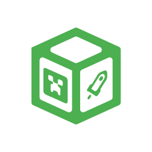

<p align="center">
  
</p>

<h1 align="center">BedrockBoot v2</h1>

<p align="center">
  <b>Industrial Grade Minecraft Bedrock Edition Launcher for Windows & Linux</b>
  <br/>
  <b>A Bedrock Edition launcher based on BedrockLauncher.Core</b>
</p>
<div align="center">

[](https://github.com/Round-Studio/BedrockBoot/releases)
[](https://github.com/Round-Studio/BedrockBoot/stargazers)
[](https://github.com/Round-Studio/BedrockBoot/releases)
[](LICENSE)

[](https://afdian.com/a/yjq666)
[](https://space.bilibili.com/1527364468)
[-00A4DB?style=flat-square&logo=tencent-qq)](https://qm.qq.com/q/ax057FTyl)
[-00A4DB?style=flat-square&logo=tencent-qq)](https://qm.qq.com/q/1VGh2ai5NS)
[-00A4DB?style=flat-square&logo=tencent-qq)](https://qm.qq.com/q/WrJFwxfaes)

</div>

---
English | [简体中文](README.md)
---

# Introduction

**BedrockBoot** is a high-performance Minecraft Bedrock Edition launcher designed for **Windows** and **Linux**.

The project aims to help users launch and manage Minecraft Bedrock efficiently.

It integrates built-in download access for the **game** itself and **CurseForge** resources, making it easier to obtain game versions and community content.

The launcher also features **PaperConnect**, an alternative multiplayer solution to traditional Xbox-based multiplayer, providing a more convenient multiplayer experience.

With support for multiple game directories and isolated instances, BedrockBoot makes managing modpacks, resource packs, and mods easier.

*\* PaperConnect is an Xbox multiplayer alternative jointly developed with **BMCBL**.*

## Features

✅ Supported, ❌ Not supported.

| Feature                            | Support     | Description                                                                                                                                                   |
| ---------------------------------- | ----------- | ------------------------------------------------------------------------------------------------------------------------------------------------------------- |
| Game Downloads                     | ✅           | Supports both GDK and UWP game versions, with full version compatibility                                                                                      |
| Resource Downloads                 | ✅           | Download Minecraft Bedrock resources directly from CurseForge, a pioneering feature among Bedrock launchers                                                   |
| Game Content Management            | ✅           | Manage resource packs, behavior packs, 4D skin packs, worlds, world templates, screenshots, and servers                                                       |
| Resource Conversion                | ✅ (Windows) | Convert resources between Java Edition and Bedrock Edition, including world conversion, Java resource pack conversion, and resource/behavior pack translation |
| World Management                   | ✅           | Back up and configure game worlds directly within the launcher                                                                                                |
| Mouse Lock                         | ✅ (Windows) | Lock the mouse cursor to prevent it from leaving the game window                                                                                              |
| Multiple Directories & Instances   | ✅           | Add multiple game directories and run multiple Minecraft instances simultaneously                                                                             |
| Multiplayer                        | ✅           | Built-in multiplayer component that works with BMCBL without requiring Xbox multiplayer                                                                       |
| Version Isolation                  | ✅ (Windows) | Isolate game resources between different instances, similar to version isolation in Minecraft Java Edition                                                    |
| Multiple Account Management        | ✅           | Log in to and switch between Xbox accounts on both Windows and Linux, with support for online game mode                                                       |
| Ways to Quick Launch               | ✅️           | Create shortcuts for individual versions, pin them to your home screen as widgets, or launch a version via the right-click on the Start menu or taskbar.      |
| Cross-Platform Support             | ✅           | Supports Windows and Linux. Linux uses ProtonGDK to run GDK games                                                                                             |
| Compatibility with Other Launchers | ✅           | Compatible with other third-party Bedrock launchers, such as BMCBL and LeviLauncher (partial support)                                                         |
| Runtime Component Setup            | ✅           | Automatically detects the game environment and installs missing runtime components before launching                                                           |
| Launcher Plugins                   | ✅           | Download officially published plugins to extend launcher functionality                                                                                        |
| Extensive Customization            | ✅           | Customize fonts, backgrounds, background music, and even 3D parallax backgrounds. Export your settings as theme packs and share them with others              |
| LeviLamina                         | ✅           | Install, manage, and load LeviLamina and its mods within game instances                                                                                       |
| DllMods                            | ✅           | Install, download, manage, and launch various DllMods directly within the launcher                                                                            |
| World Map Editing & Preview        | ❌           | World map preview and editing are not currently supported. (COMING SOON~~)                                                     |

## Related Links

- **Official Website**: [BedrockBoot Official Website](https://roundstudio.top/bedrockboot)
- **Documentation**: [BedrockBoot Documentation](https://docs.roundstudio.top/docs/product/bb)
- **Privacy Policy**: [BedrockBoot Privacy Policy](https://docs.roundstudio.top/docs/product/bb/privacyPolicy)

# Download

You can obtain BedrockBoot binaries through the following official channels:

| Channel                      | Link                                                                          |
| ---------------------------- | ----------------------------------------------------------------------------- |
| **Official Download Portal** | [Round Studio Download](https://roundstudio.top/bedrockboot)                  |
| **GitHub Releases**          | [GitHub Release Assets](https://github.com/Round-Studio/BedrockBoot/releases) |

# Quick Start

## Windows

1. **System Requirements**: Ensure that your system is running Windows 10 (Build 19041 or later) or Windows 11.
2. **Installation**: Download the release package to a directory outside system-protected locations, then run `BedrockBoot.exe`.
3. **Download Game Versions**: Open the **Download** module and download your desired Minecraft Bedrock version or resource packs.
4. **Launch**: Configure your instance settings and click **Launch** to start the game.

## Linux

### Installation

#### Arch Linux

Install via [AUR](https://aur.archlinux.org/packages/bedrockboot):

```bash
paru -S bedrockboot
```

#### Other Linux Distributions

Download the release package and run `BedrockBoot.AppImage`.

### First Launch

1. **Install Dependencies**: On the first launch, you will need to download the `ProtonGDK` runtime dependencies.
2. **Download Game Versions**: Open the **Download** module and download your desired Minecraft Bedrock version or resource packs.
3. **Launch**: Configure your instance settings and click **Launch** to start the game.

# Contribution

BedrockBoot is an open-source, community-driven project. Contributions of all kinds are welcome.

- **Bug Reports & Suggestions**: Submit bug reports or feature requests through [GitHub Issues](https://github.com/Round-Studio/BedrockBoot/issues).
- **Pull Requests**: Fork this repository and submit a Pull Request. Please ensure that your code passes basic unit tests before submitting.
- **Tech Stack**: C# / C++ / .NET / [Avalonia](https://github.com/avaloniaui).

# Build From Source

If you want to compile or debug the project yourself, follow these steps:

1. Install [Visual Studio 2022](https://visualstudio.microsoft.com/) or [Rider](https://www.jetbrains.com/rider/), and make sure the `.NET Desktop Development` workload is installed.
2. Make sure the **.NET 10.0 SDK** is installed.
3. Clone the repository and build the project:

```bash
git clone --recursive https://github.com/Round-Studio/BedrockBoot.git -b 2.0-develop
cd ./BedrockBoot
dotnet build -c Release
```

# Team & Credits

## Core Developers

- **Lead Developers**: Dime, YoumiHa
- **UI/UX Design**: Dime, DrMing
- **Core Architecture**: YoumiHa

# License

This program is released under the **GPLv3** open-source license, with the following additional terms:

1. **Marking Modified Versions**: When distributing modified versions, you must reasonably modify the program name or version number.
2. **Copyright Notices**: You must not remove or obscure any copyright notices embedded in the program.

---
<p align="right"><i>Refined by Round Studio Architecture</i></p>
