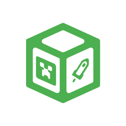

<p align="center">
  
</p>

<h1 align="center">BedrockBoot v2</h1>

<p align="center">
  <b>Windows ve Linux için Endüstriyel Düzeyde Minecraft Bedrock Edition Başlatıcısı</b>
  <br/>
  <b>BedrockLauncher.Core tabanlı bir Bedrock Edition başlatıcısı</b>
</p>
<div align="center">

[](https://github.com/Round-Studio/BedrockBoot/releases)
[](https://github.com/Round-Studio/BedrockBoot/stargazers)
[](https://github.com/Round-Studio/BedrockBoot/releases)
[](LICENSE)

[](https://afdian.com/a/yjq666)
[](https://space.bilibili.com/1527364468)
[-00A4DB?style=flat-square&logo=tencent-qq)](https://qm.qq.com/q/ax057FTyl)
[-00A4DB?style=flat-square&logo=tencent-qq)](https://qm.qq.com/q/1VGh2ai5NS)
[-00A4DB?style=flat-square&logo=tencent-qq)](https://qm.qq.com/q/WrJFwxfaes)

</div>

---
[English](README_EN.md) | [简体中文](README.md) | Türkçe
---

# Giriş

**BedrockBoot**, **Windows** ve **Linux** için tasarlanmış yüksek performanslı bir Minecraft Bedrock Edition başlatıcısıdır.

Proje, kullanıcıların Minecraft Bedrock'ı verimli bir şekilde başlatmasına ve yönetmesine yardımcı olmayı amaçlamaktadır.

**Oyunun** kendisi ve **CurseForge** kaynakları için yerleşik indirme erişimini bütünleştirerek oyun sürümlerini ve topluluk içeriklerini edinmeyi kolaylaştırır.

Başlatıcı ayrıca geleneksel Xbox tabanlı çok oyunculu moduna alternatif bir çözüm olan ve daha rahat bir çok oyunculu deneyimi sunan **PaperConnect** özelliğine sahiptir.

Birden fazla oyun dizini ve yalıtılmış örnek (instance) desteğiyle BedrockBoot, mod paketlerini, kaynak paketlerini ve modları yönetmeyi kolaylaştırır.

*\* PaperConnect, **BMCBL** ile ortaklaşa geliştirilen bir Xbox çok oyunculu alternatifidir.*

## Özellikler

✅ Desteklenir, ❌ Desteklenmez.

| Özellik                               | Destek       | Açıklama                                                                                                                                                     |
| ------------------------------------- | ------------ | ------------------------------------------------------------------------------------------------------------------------------------------------------------ |
| Oyun İndirmeleri                      | ✅            | Tam sürüm uyumluluğuyla hem GDK hem de UWP oyun sürümlerini destekler                                                                                        |
| Kaynak İndirmeleri                    | ✅            | Bedrock başlatıcıları arasında öncü bir özellik olarak Minecraft Bedrock kaynaklarını doğrudan CurseForge'dan indirin                                        |
| Oyun İçeriği Yönetimi                 | ✅            | Kaynak paketlerini, davranış paketlerini, 4D dış görünüm paketlerini, dünyaları, dünya şablonlarını, ekran görüntülerini ve sunucuları yönetin               |
| Kaynak Dönüştürme                     | ✅ (Windows)  | Dünya dönüştürme, Java kaynak paketi dönüştürme ve kaynak/davranış paketi çevirisi dahil Java Edition ile Bedrock Edition arasında kaynakları dönüştürün      |
| Dünya Yönetimi                        | ✅            | Oyun dünyalarını doğrudan başlatıcı içinden yedekleyin ve yapılandırın                                                                                       |
| Fare Kilidi                           | ✅ (Windows)  | Fare imlecinin oyun penceresinden çıkmasını önlemek için kilitleyin                                                                                          |
| Çoklu Dizinler ve Örnekler            | ✅            | Birden fazla oyun dizini ekleyin ve aynı anda birden fazla Minecraft örneği çalıştırın                                                                       |
| Çok Oyunculu                          | ✅            | Xbox çok oyunculu gerektirmeden BMCBL ile çalışan yerleşik çok oyunculu bileşeni                                                                             |
| Sürüm Yalıtımı                        | ✅ (Windows)  | Minecraft Java Edition'daki sürüm yalıtımına benzer şekilde farklı örnekler arasındaki oyun kaynaklarını yalıtın                                             |
| Çoklu Hesap Yönetimi                  | ✅            | Çevrimiçi oyun modu desteğiyle hem Windows hem de Linux'ta Xbox hesaplarına giriş yapın ve hesaplar arasında geçiş yapın                                     |
| Hızlı Başlatma Yolları                | ✅️           | Ayrı sürümler için kısayollar oluşturun, bunları ana ekranınıza widget olarak sabitleyin veya Başlat menüsüne ya da görev çubuğuna sağ tıklayarak başlatın  |
| Çapraz Platform Desteği               | ✅            | Windows ve Linux'u destekler. Linux, GDK oyunlarını çalıştırmak için ProtonGDK kullanır                                                                      |
| Diğer Başlatıcılarla Uyumluluk        | ✅            | BMCBL ve LeviLauncher (kısmi destek) gibi diğer üçüncü taraf Bedrock başlatıcılarıyla uyumludur                                                              |
| Çalışma Zamanı Bileşeni Kurulumu      | ✅            | Başlatmadan önce oyun ortamını otomatik olarak algılar ve eksik çalışma zamanı bileşenlerini kurar                                                           |
| Başlatıcı Eklentileri                 | ✅            | Başlatıcı işlevselliğini genişletmek için resmi olarak yayımlanan eklentileri indirin                                                                        |
| Kapsamlı Özelleştirme                 | ✅            | Yazı tiplerini, arka planları, arka plan müziğini ve hatta 3D paralaks arka planlarını özelleştirin. Ayarlarınızı tema paketi olarak dışa aktarın ve paylaşın |
| LeviLamina                            | ✅            | Oyun örnekleri içinde LeviLamina ve modlarını kurun, yönetin ve yükleyin                                                                                     |
| DllMods                               | ✅            | Çeşitli DllMods modlarını doğrudan başlatıcı içinden kurun, indirin, yönetin ve başlatın                                                                     |
| Dünya Haritası Düzenleme ve Önizleme  | ❌            | Dünya haritası önizleme ve düzenleme şu anda desteklenmemektedir. (YAKINDA~~)                                                                                |

## İlgili Bağlantılar

- **Resmi Web Sitesi**: [BedrockBoot Resmi Web Sitesi](https://roundstudio.top/bedrockboot)
- **Belgeler**: [BedrockBoot Belgeleri](https://docs.roundstudio.top/docs/product/bb)
- **Gizlilik Politikası**: [BedrockBoot Gizlilik Politikası](https://docs.roundstudio.top/docs/product/bb/privacyPolicy)

# İndirme

BedrockBoot ikili dosyalarını aşağıdaki resmi kanallar üzerinden edinebilirsiniz:

| Kanal                      | Bağlantı                                                                       |
| -------------------------- | ------------------------------------------------------------------------------ |
| **Resmi İndirme Portalı**  | [Round Studio İndirme](https://roundstudio.top/bedrockboot)                    |
| **GitHub Sürümleri**       | [GitHub Sürüm Dosyaları](https://github.com/Round-Studio/BedrockBoot/releases) |

# Hızlı Başlangıç

## Windows

1. **Sistem Gereksinimleri**: Sisteminizin Windows 10 (Derleme 19041 veya üzeri) veya Windows 11 çalıştırdığından emin olun.
2. **Kurulum**: Sürüm paketini sistem korumalı konumların dışındaki bir dizine indirin, ardından `BedrockBoot.exe` dosyasını çalıştırın.
3. **Oyun Sürümlerini İndirme**: **Download** modülünü açın ve istediğiniz Minecraft Bedrock sürümünü veya kaynak paketlerini indirin.
4. **Başlatma**: Örnek (instance) ayarlarınızı yapılandırın ve oyunu başlatmak için **Launch** düğmesine tıklayın.

## Linux

### Kurulum

#### Arch Linux

[AUR](https://aur.archlinux.org/packages/bedrockboot) üzerinden kurun:

```bash
paru -S bedrockboot
```

#### Diğer Linux Dağıtımları

Sürüm paketini indirin ve `BedrockBoot.AppImage` dosyasını çalıştırın.

### İlk Başlatma

1. **Bağımlılıkları Kurun**: İlk başlatmada `ProtonGDK` çalışma zamanı bağımlılıklarını indirmeniz gerekecektir.
2. **Oyun Sürümlerini İndirme**: **Download** modülünü açın ve istediğiniz Minecraft Bedrock sürümünü veya kaynak paketlerini indirin.
3. **Başlatma**: Örnek ayarlarınızı yapılandırın ve oyunu başlatmak için **Launch** düğmesine tıklayın.

# Katkıda Bulunma

BedrockBoot açık kaynaklı, topluluk odaklı bir projedir. Her türlü katkı memnuniyetle karşılanır.

- **Hata Bildirimleri ve Öneriler**: Hata bildirimlerini veya özellik isteklerini [GitHub Issues](https://github.com/Round-Studio/BedrockBoot/issues) üzerinden gönderin.
- **Pull Request'ler**: Bu depoyu çatallayın (fork) ve bir Pull Request gönderin. Lütfen göndermeden önce kodunuzun temel birim testlerinden geçtiğinden emin olun.
- **Teknoloji Yığını**: C# / C++ / .NET / [Avalonia](https://github.com/avaloniaui).

# Kaynak Koddan Derleme

Projeyi kendiniz derlemek veya hata ayıklamak istiyorsanız şu adımları izleyin:

1. [Visual Studio 2022](https://visualstudio.microsoft.com/) veya [Rider](https://www.jetbrains.com/rider/) kurun ve `.NET Desktop Development` iş yükünün kurulu olduğundan emin olun.
2. **.NET 10.0 SDK**'nın kurulu olduğundan emin olun.
3. Depoyu klonlayın ve projeyi derleyin:

```bash
git clone --recursive https://github.com/Round-Studio/BedrockBoot.git -b 2.0-develop
cd ./BedrockBoot
dotnet build -c Release
```

# Ekip ve Emeği Geçenler

## Çekirdek Geliştiriciler

- **Baş Geliştiriciler**: Dime, YoumiHa
- **UI/UX Tasarımı**: Dime, DrMing
- **Çekirdek Mimarisi**: YoumiHa

# Lisans

Bu program aşağıdaki ek koşullarla **GPLv3** açık kaynak lisansı altında yayımlanmaktadır:

1. **Değiştirilmiş Sürümlerin İşaretlenmesi**: Değiştirilmiş sürümleri dağıtırken program adını veya sürüm numarasını makul ölçüde değiştirmeniz gerekir.
2. **Telif Hakkı Bildirimleri**: Programa gömülü hiçbir telif hakkı bildirimini kaldırmamalı veya gizlememelisiniz.

---
<p align="right"><i>Round Studio Architecture tarafından geliştirilmiştir</i></p>
